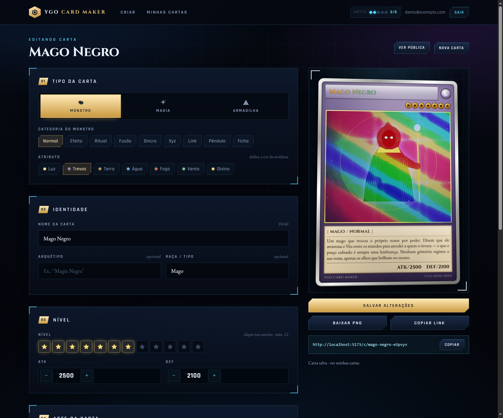
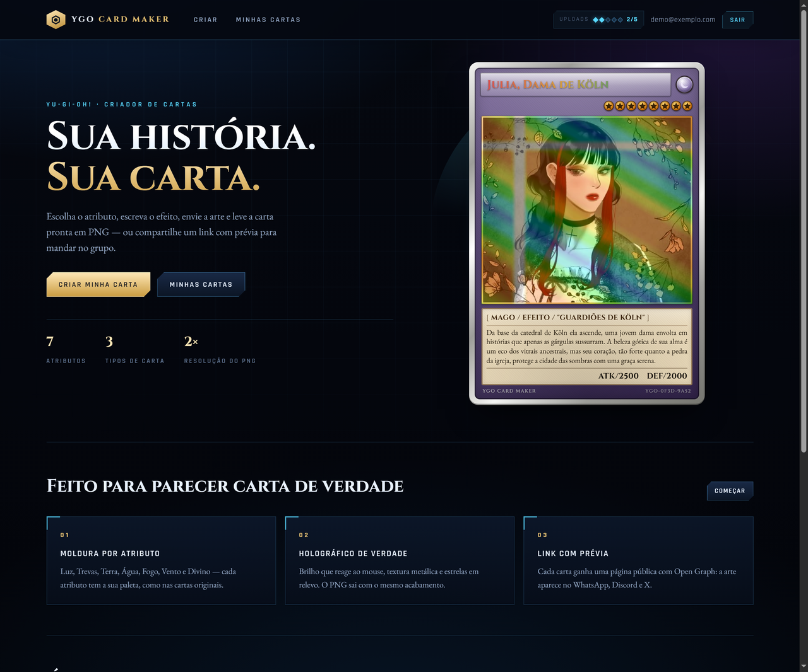
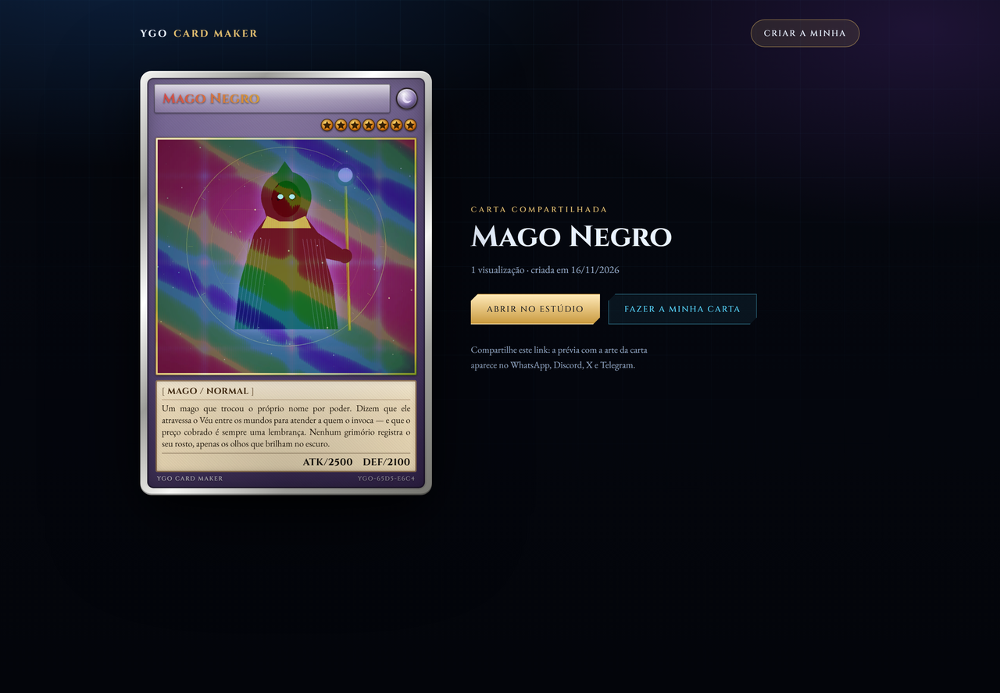
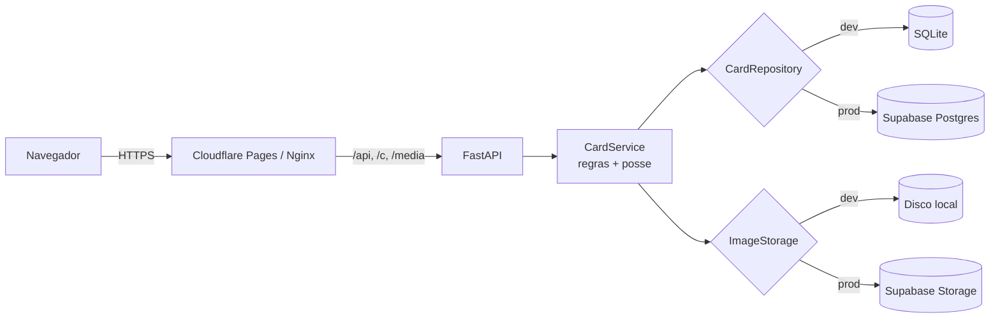

# Projeto B — YGO Card Maker

**Nível declarado: Projeto B** (API de domínio único, um fluxo principal de ponta a ponta).

[](https://github.com/mateusjairan/YGO_card_maker/actions/workflows/ci.yml)
[](docs/desempenho.md)
[](docs/desempenho.md)
[](#licença)

Criador de cartas customizadas de Yu-Gi-Oh!: você monta a carta no navegador com a sua arte,
moldura por atributo, brilho holográfico, exporta em PNG 2× e compartilha um link que já abre
com prévia no WhatsApp/Discord/X.

<p align="center">
  
</p>

| Camada | Tecnologia |
| --- | --- |
| Frontend | React 18 + TypeScript + Vite (SPA) |
| Backend | FastAPI + Pydantic v2 (Python 3.13) |
| Banco | Supabase Postgres (produção) · SQLite (desenvolvimento e testes) |
| Storage | Supabase Storage (produção) · disco local (desenvolvimento) |
| Infra | Docker Compose · Nginx · GitHub Actions |
| Deploy | Cloudflare Pages (front) · Render (API em Docker) · Supabase (banco/storage) |

---

## Sumário

- [O que funciona](#o-que-funciona)
- [Como subir com um comando](#como-subir-com-um-comando)
- [Como rodar sem Docker](#como-rodar-sem-docker)
- [Como testar](#como-testar)
- [API](#api)
- [Arquitetura](#arquitetura)
- [Supabase](#supabase)
- [Deploy](#deploy)
- [Observabilidade e SLO](#observabilidade-e-slo)
- [Branches](#branches)
- [Estrutura do repositório](#estrutura-do-repositório)
- [Checklist da rubrica](#checklist-da-rubrica)
- [Limites conhecidos](#limites-conhecidos)

---

## O que funciona

Fluxo principal: **criar → salvar → compartilhar**.

- **Três tipos de carta** — Monstro (9 categorias: normal, efeito, ritual, fusão, sincro, xyz,
  link, pêndulo, ficha), Magia (6) e Armadilha (3).
- **Moldura por atributo** — Luz, Trevas, Terra, Água, Fogo, Vento e Divino têm paleta própria,
  como nas cartas originais; magia e armadilha usam o verde e o rosa clássicos.
- **Nível/Rank/Link** — estrelas clicáveis, estrelas escuras para Xyz e selo `LINK-n` para Link.
- **Upload de arte** com validação de tipo/tamanho e reencode automático para WebP (máx. 1400 px).
- **Prévia em tempo real** com o mesmo CSS usado na página pública.
- **Exportação em PNG 2×** (840×1224) direto do DOM.
- **Página pública SSR** em `/c/{slug}` com Open Graph (a arte aparece na prévia do link).
- **Galeria pública** na home, **minhas cartas** por identidade anônima do navegador.
- **Editar e excluir** apenas as próprias cartas (chave de dono + hash SHA-256 no servidor).

<p align="center">
  
  
</p>

## Como subir com um comando

Pré-requisitos: **Docker** (Desktop ou Engine + Compose v2).

```bash
cp .env.example .env     # opcional para o modo local (SQLite)
docker compose up --build
```

| Serviço | URL |
| --- | --- |
| Aplicação (nginx + SPA + proxy) | http://localhost:8080 |
| API (direto) | http://localhost:8000 |
| Swagger UI | http://localhost:8000/docs |
| Métricas | http://localhost:8000/metrics |
| Health check | http://localhost:8000/health |

O `docker-compose.yml` sobe a API com healthcheck e o front só inicia depois que a API responde.
No modo padrão os dados ficam em um volume Docker (`api-data`), em SQLite — nenhuma credencial
externa é necessária para a aplicação rodar.

## Como rodar sem Docker

**API** (Python 3.11+):

```bash
python -m venv .venv
# Windows: .venv\Scripts\activate  ·  Linux/macOS: source .venv/bin/activate
pip install -r requirements-dev.txt

uvicorn app.main:create_app --factory --host 127.0.0.1 --port 8000
# ou: PYTHONPATH=src uvicorn app.main:create_app --factory
```

**Web** (Node 20+ e pnpm):

```bash
cd web
pnpm install
pnpm dev            # http://localhost:5173
```

O Vite faz proxy de `/api`, `/c`, `/media` e `/static` para `http://127.0.0.1:8000`, então o
link de compartilhamento funciona igual em desenvolvimento e em produção (mesma origem).

## Como testar

```bash
# Backend: 73 testes, cobertura obrigatória de 80% (atingido: 92,5%)
pytest

# Lint e formatação Python
ruff check src tests
ruff format --check src tests

# Frontend
cd web
pnpm lint
pnpm build

# Smoke test do fluxo completo contra uma API em execução
node scripts/smoke.mjs http://127.0.0.1:8000

# Carga (k6): p95 < 300 ms e < 1% de falhas
k6 run load/k6-smoke.js
```

Os testes cobrem regras de domínio (validação de tipo/atributo/nível, slug, linha de tipo),
o repositório SQLite, a API inteira via HTTP, upload de imagem, página pública e métricas.
Resultados de carga medidos em [docs/desempenho.md](docs/desempenho.md).

## API

Documentação viva em `/docs` (Swagger) e contrato versionado em
[docs/openapi.yaml](docs/openapi.yaml) — gerado do código por `python scripts/export_openapi.py`
e validado no CI (o build falha se o YAML ficar desatualizado).

| Método | Rota | Descrição | Auth |
| --- | --- | --- | --- |
| `POST` | `/api/cards` | Cria carta | `X-Owner-Key` |
| `GET` | `/api/cards` | Galeria pública (`limit`, `offset`, `q`) | — |
| `GET` | `/api/cards/mine` | Cartas do dono da chave | `X-Owner-Key` |
| `GET` | `/api/cards/{id}` | Detalhe | — |
| `GET` | `/api/cards/slug/{slug}` | Detalhe pela URL amigável | — |
| `PATCH` | `/api/cards/{id}` | Atualização parcial | dono |
| `DELETE` | `/api/cards/{id}` | Remove carta + imagem | dono |
| `POST` | `/api/uploads` | Upload da arte (→ WebP) | — |
| `GET` | `/c/{slug}` | Página pública com Open Graph | — |
| `GET` | `/health`, `/metrics` | Health check e Prometheus | — |

**Identidade sem login:** o navegador gera uma chave aleatória (`localStorage`) e envia em
`X-Owner-Key`. O servidor guarda apenas `sha256(salt + chave)`, nunca a chave em texto puro.
Quem tem a chave edita; quem não tem recebe `403`.

Exemplo:

```bash
curl -X POST http://localhost:8000/api/cards \
  -H 'Content-Type: application/json' \
  -H 'X-Owner-Key: minha-chave-anonima-1234' \
  -d '{"name":"Aurora do Véu","kind":"monster","monster_kind":"effect",
       "attribute":"light","race":"Fada","level":7,"atk":2400,"defense":1800,
       "description":"Quando esta carta é invocada, o primeiro desejo vira escudo."}'
```

## Arquitetura



Decisões e alternativas descartadas estão em
[docs/adr/0001-arquitetura-em-camadas.md](docs/adr/0001-arquitetura-em-camadas.md).

O **Repository Pattern** é o padrão justificado: a API não conhece SQL nem PostgREST, então o
mesmo serviço de domínio roda em SQLite (desenvolvimento/testes) e Supabase (produção). O
`CardService` concentra as regras de posse, limite por duelista e geração de slug; as rotas
apenas traduzem HTTP.

> O CSS da carta é **uma única fonte** (`shared/card.css`), importada pelo React e servida ao
> template Jinja da página pública. Assim a prévia do editor e o compartilhamento não divergem.

## Supabase

1. Crie um projeto em [supabase.com](https://supabase.com) (plano free).
2. Rode as migrations (SQL Editor ou CLI):

   ```bash
   supabase link --project-ref SEU_REF
   supabase db push          # aplica supabase/migrations/*.sql
   ```

   As migrations criam a tabela `public.cards` com RLS habilitado (sem policies: só a
   `service_role` acessa), o índice de galeria, a função `increment_card_views` e o bucket
   público `card-images`.
3. Configure a API (nunca no front):

   ```dotenv
   STORAGE_BACKEND=supabase
   SUPABASE_URL=https://xxxx.supabase.co
   SUPABASE_SERVICE_ROLE_KEY=eyJ...   # segredo de servidor
   SUPABASE_BUCKET=card-images
   PUBLIC_BASE_URL=https://sua-api.onrender.com
   FRONTEND_BASE_URL=https://seu-site.pages.dev
   ```

4. Gere uma salt própria: `OWNER_KEY_SALT=$(openssl rand -hex 32)`.

Com `STORAGE_BACKEND=supabase` a API passa a usar PostgREST e o Storage; nada muda no frontend.

## Deploy

**Frontend — Cloudflare Pages (free tier):**

```bash
cd web
pnpm build
npx wrangler pages deploy dist --project-name ygo-card-maker
```

O arquivo `web/public/_redirects` faz o proxy de `/api`, `/c`, `/media`, `/static`, `/docs` e
`/openapi.json` para a API na mesma origem — sem CORS e com links curtos. **Troque a URL de
exemplo pela URL do seu deploy** antes de publicar.

**API — Render (Docker, free tier):** novo Web Service a partir do repositório, runtime Docker,
health check `/health`; variáveis conforme `.env.example`.

**Banco/Storage — Supabase:** migrations acima; a `service_role` fica só no Render.

**Alternativa 100% Docker:** `docker compose up -d --build` em qualquer VPS (o nginx já faz o
proxy da API, então o front e a API ficam no mesmo domínio).

## Observabilidade e SLO

- **Logs estruturados** em JSON, uma linha por evento, com `request_id`, método, rota, status e
  `duration_ms` (`app.access`). Exemplo:

  ```json
  {"timestamp": "2026-11-15 18:06:21,312", "level": "INFO", "logger": "app.access",
   "message": "request_completed", "request_id": "9f2c1a7b3d4e", "method": "POST",
   "path": "/api/cards", "status": 201, "duration_ms": 23.41}
  ```

- **Métricas Prometheus** em `/metrics`: `http_requests_total`, `http_request_duration_seconds`
  (RED por rota), `ygo_cards_created_total{kind}`, `ygo_card_views_total`, `ygo_uploads_total`
  e o histograma `ygo_card_create_duration_seconds`.
- **SLO:** 99% das requisições de leitura com **p95 < 300 ms** e taxa de erro < 1% em janela de
  30 dias. Medido com k6: **p95 = 65,2 ms** (4,6× de folga) e 0% de falhas — detalhes e
  metodologia em [docs/desempenho.md](docs/desempenho.md).

## Branches

| Branch | Papel |
| --- | --- |
| `main` | linha estável, o que é avaliado |
| `dev` | integração do dia a dia (feature branches saem daqui) |
| `tests` | suíte de testes, fixtures e ajustes de cobertura |
| `prod` | tag de release/deploy; só recebe merge de `main` validada |

Fluxo: `feature/*` → `dev` → `tests` (testes do que entrou) → `main` → `prod` + tag `v1.0.0`.

## Estrutura do repositório

```text
.
├─ docker-compose.yml
├─ Dockerfile                  # API (FastAPI)
├─ README.md
├─ CONTRIBUTORS.md
├─ .env.example
├─ .github/workflows/ci.yml
├─ src/app/                    # API
│  ├─ main.py                  # composition root
│  ├─ config.py
│  ├─ core/                    # logs, erros, métricas
│  ├─ domain/                  # modelos, regras, schemas
│  ├─ repositories/            # SQLite + Supabase (Repository Pattern)
│  ├─ services/                # regras de negócio e upload
│  ├─ storage/                 # disco local + Supabase Storage
│  ├─ api/routes/              # cartas, uploads, páginas, sistema
│  └─ templates/               # página pública SSR
├─ shared/card.css             # CSS da carta (React + Jinja)
├─ web/                        # React + Vite
│  ├─ src/components|pages|lib
│  ├─ Dockerfile · nginx.conf
│  └─ public/_redirects         # Cloudflare Pages
├─ supabase/migrations/        # schema + bucket
├─ tests/                      # pytest (unit + integração)
├─ load/k6-smoke.js            # carga
├─ scripts/                    # smoke manual e export do OpenAPI
└─ docs/
   ├─ adr/0001-arquitetura-em-camadas.md
   ├─ desempenho.md
   ├─ openapi.yaml
   └─ ia.md
```

## Checklist da rubrica

| Critério | Evidência |
| --- | --- |
| **M1** — funciona, código e design | `docker compose up` sobe tudo; Repository Pattern justificado no ADR; SOLID (domínio isolado, injeção em `main.py`); interface autoral |
| **M2** — testes e CI | `pytest` (73 testes, 92,5% ≥ 80%), 1 teste de integração por fluxo, ESLint + `tsc`, [CI verde](https://github.com/mateusjairan/YGO_card_maker/actions/workflows/ci.yml) ([`.github/workflows/ci.yml`](.github/workflows/ci.yml)) |
| **M3** — ambientes, segredos, observabilidade | `.env.example`, segredos só no servidor, logs JSON, `/metrics`, SLO declarado |
| **M4** — arquitetura, documentação, desempenho | [ADR](docs/adr/0001-arquitetura-em-camadas.md), [OpenAPI](docs/openapi.yaml) validado no CI, [k6 + p95](docs/desempenho.md), README |

## Limites conhecidos

- **Sem login**: a posse é por chave anônima do navegador. Trocar de dispositivo perde o acesso
  de edição (a carta pública continua acessível pelo link). Autenticação Supabase é o próximo passo.
- **Sem moderação** de conteúdo na galeria pública.
- A integração Supabase está implementada em repositório e storage próprios, com migrations
  prontas; o fluxo validado em execução contínua é o SQLite local (o mesmo contrato).
- Sem testes E2E de navegador (o fluxo é coberto por API + smoke manual) e sem cache Redis —
  ambos listados em [docs/desempenho.md](docs/desempenho.md) como próximos passos.

## Uso de IA

Declarado em [docs/ia.md](docs/ia.md), conforme combinado no curso. A decisão de arquitetura e
a revisão do código são do autor.

## Licença

MIT. As artes enviadas pelos usuários continuam sendo dos respectivos autores; o projeto não
distribui material oficial de Yu-Gi-Oh! (nome e estética são usados apenas em trabalho acadêmico).
