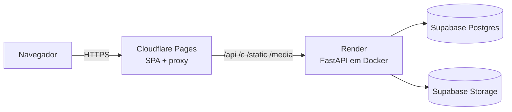

# Deploy — Cloudflare Pages (front) + Render (API) + Supabase (banco)

Tempo estimado: **35–45 min**, sem alterar código.



O Pages faz proxy de `/api`, `/c`, `/media`, `/static`, `/docs` para a API — o navegador vê **uma
origem só**: sem CORS, link curto `/c/{slug}` e Open Graph funcionando.

---

## 1. Supabase (~10 min)

1. Crie o projeto em [supabase.com](https://supabase.com) (free), região **South America (São Paulo)**
   se estiver disponível na sua conta.
2. Aplique as migrations (CLI ou SQL Editor):

   ```bash
   supabase link --project-ref SEU_REF
   supabase db push
   ```

   Ou cole, nesta ordem, `supabase/migrations/20261115000000_init.sql` e
   `20261115000100_storage.sql` no SQL Editor.
3. **Atalho**: o script valida as chaves, aplica as migrations e escreve o `.env`:

   ```bash
   python scripts/setup-supabase.py \
     --url https://SEU-REF.supabase.co \
     --service-key "$SUPABASE_SERVICE_ROLE_KEY" \
     --access-token "$SUPABASE_ACCESS_TOKEN"   # opcional: aplica as migrations
   ```

   Ele também detecta se você colou a `anon` key por engano e avisa se faltar tabela/bucket.
4. Confira no dashboard:
   - `public.users` e `public.cards` existem e estão com **RLS habilitado**;
   - funções `increment_card_views` e `sync_user_uploads` criadas;
   - bucket `card-images` **público** (leitura) com limite de 6 MB.
4. Anote `Project URL` e `service_role key` (Project Settings → API). A `service_role` **nunca**
   vai para o front.

## 2. API no Render (~15 min)

O repositório tem `render.yaml` (Blueprint). No dashboard: **New → Blueprint → selecione o repo**.

Se preferir manual: **New → Web Service → Runtime Docker**, branch `prod`, Health Check `/health`.

Variáveis (as `sync: false` você preenche):

| Variável | Valor |
| --- | --- |
| `APP_ENV` | `production` |
| `LOG_FORMAT` | `json` |
| `STORAGE_BACKEND` | `supabase` |
| `SUPABASE_URL` | `https://xxxx.supabase.co` |
| `SUPABASE_SERVICE_ROLE_KEY` | segredo do Supabase |
| `SUPABASE_BUCKET` | `card-images` |
| `SECRET_KEY` | `openssl rand -hex 32` (o Blueprint gera sozinho) |
| `PUBLIC_BASE_URL` | `https://ygo-card-maker-api.onrender.com` |
| `FRONTEND_BASE_URL` | `https://ygo-card-maker.pages.dev` |
| `CORS_ORIGINS` | a URL do Pages |
| `MAX_UPLOADS_PER_USER` | `5` |
| `IMAGE_OUTPUT_PX` | `1024` |

Valide:

```bash
curl -s https://SEU-SERVICO.onrender.com/health
# {"status":"ok",...,"checks":{"database":true}}

curl -s https://SEU-SERVICO.onrender.com/docs | head -c 80   # Swagger
```

> **Cold start:** no plano free o serviço dorme após ~15 min. A primeira requisição leva ~30–50 s.
> Para a apresentação, abra `/health` 2 minutos antes; ou use um ping de 10 min
> (cron-job.org / GitHub Actions) ou o plano Starter.

## 3. Front no Cloudflare Pages (~10 min)

1. **Workers & Pages → Create → Pages → Connect to Git** e escolha o repositório.
2. Configuração de build:

   | Campo | Valor |
   | --- | --- |
   | Framework preset | *None* / Vite |
   | Root directory | `web` |
   | Build command | `pnpm build` |
   | Build output directory | `dist` |
   | Env var | `NODE_VERSION=22` |

3. Aponte o proxy para a sua API: edite `web/public/_redirects` trocando
   `https://ygo-card-maker-api.onrender.com` pela URL do Render.

   ```bash
   sed -i 's|https://SEU-SERVICO.onrender.com|https://SUA-API.onrender.com|g' web/public/_redirects
   ```

   O arquivo precisa continuar em `web/public/` (o Vite copia para `dist/`).
4. Commit na `prod` → o Pages builda e publica. URL: `https://SEU-PROJETO.pages.dev`.

Se usar domínio próprio, adicione em **Custom domains** e ajuste `FRONTEND_BASE_URL`/`CORS_ORIGINS`
no Render.

## 4. Validação pós-deploy (~10 min)

```bash
# fluxo completo (auth, cota, posse, XSS, CORS) contra produção
node scripts/e2e-api.mjs https://SEU-SERVICO.onrender.com
```

No navegador, com o site do Pages:

1. criar conta → criar carta → salvar;
2. subir uma arte (deve padronizar em 1024×1024 WebP e a cota ir para 1/5);
3. **Baixar PNG** (840×1224);
4. copiar o link `/c/{slug}` e abrir no WhatsApp/Discord — a prévia deve mostrar a arte;
5. testar no celular (390 px) e conferir “Minhas cartas”.

## 5. Operação

- **Logs**: Render → Logs (JSON, `request_completed` com `status` e `duration_ms`). Filtre por
  `"level": "ERROR"`.
- **Métricas**: `https://SEU-SERVICO.onrender.com/metrics` (Prometheus). Grafana Cloud free ou
  VictoriaMetrics free fazem o scrape.
- **Uptime**: BetterStack/cron-job batendo em `/health` a cada 5–10 min — serve também de
  keep-alive contra o cold start.
- **Rollback**: Render → Deploys → *Rollback* para o deploy anterior. As migrations são aditivas,
  então voltar a API não exige voltar o banco.
- **Rotação de segredo**: trocar `SECRET_KEY` invalida os JWT emitidos (todo mundo reloga).

## 6. Alternativa: tudo em Docker numa VPS

```bash
git clone https://github.com/mateusjairan/YGO_card_maker && cd YGO_card_maker
cp .env.example .env   # STORAGE_BACKEND=supabase + chaves
docker compose up -d --build
```

O `docker-compose.yml` sobe a API (com healthcheck) e o nginx servindo o SPA + proxy na porta 8080.
Ponha Caddy/Traefik na frente para TLS. Sem cold start.

## Troubleshooting

| Sintoma | Causa provável | Solução |
| --- | --- | --- |
| 502 no Pages | API dormiu / URL errada em `_redirects` | abrir `/health`; conferir a URL |
| `CORS` bloqueando | `CORS_ORIGINS` sem a URL do Pages | ajustar no Render e redeployar |
| Imagem some | bucket privado | deixar `card-images` público (leitura) |
| OG sem imagem | `og:image` relativo | conferir `PUBLIC_BASE_URL` (precisa ser a URL pública da API) |
| 500 no `/health` | chave do Supabase errada | conferir `SUPABASE_URL`/`SERVICE_ROLE` |
| `database: false` | migrations não aplicadas | rodar `supabase db push` |
| `403 permission denied for table` | projeto sem GRANT para a `service_role` | rodar `supabase/migrations/20261115000200_grants.sql` (ou `supabase/setup.sql`) |
| `401 Secret API key required` | usou a chave publishable no backend | usar a secret (`sb_secret_…`) em `SUPABASE_SERVICE_ROLE_KEY` |
